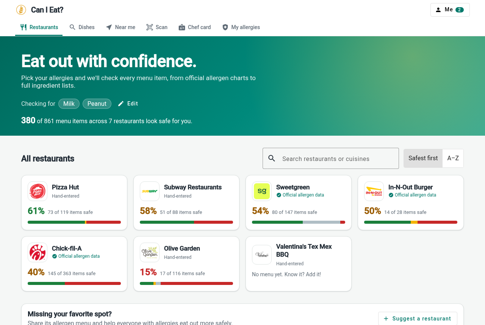
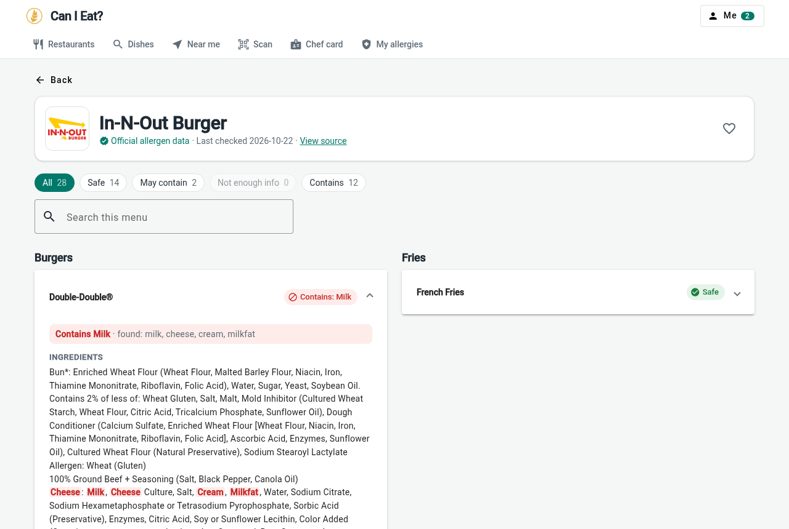
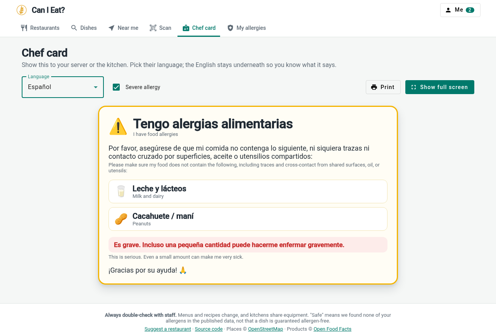
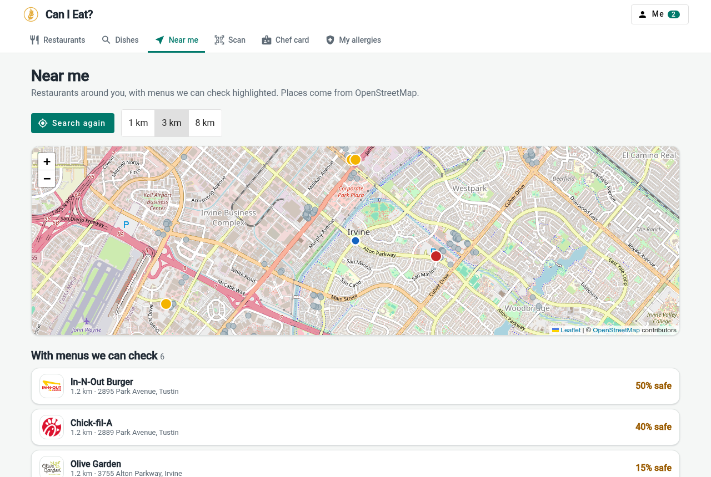
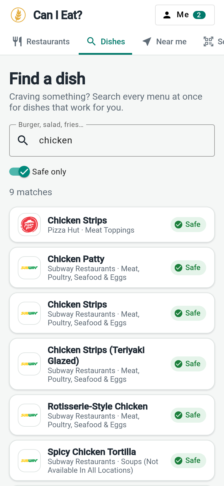

# Can I Eat?

Pick your food allergies and see which menu items are safe at restaurants, checked against official allergen charts and full ingredient lists.

**Live:** https://can-i-eat.vercel.app · ☕ [Buy me a coffee](https://buymeacoffee.com/relvingonzalez)



## Features

- **Restaurant safety ratings.** Every menu item is checked against your allergies and marked *Safe*, *May contain*, *Contains*, or *Not enough info*.
- **Smart matching.** "Milk" also catches whey, casein, butter, ghee and friends; "egg" doesn't flag eggplant; "may contain" and "produced in a facility with" statements count as cross-contact; refined soybean/peanut oil shows as a heads-up instead of a hard fail. Matched words are highlighted in the ingredient list.
- **Find a dish.** Search every menu at once ("chicken", "shake") for dishes that work for you.
- **Near me.** Nearby restaurants on a map, highlighting the ones with menus we can check, plus allergy-friendly tags (gluten-free, vegan…) from OpenStreetMap.
- **Scan a product.** Scan a grocery barcode and check it with Open Food Facts.
- **Chef card.** A full-screen card listing your allergies in 8 languages to show your server.
- **Profiles.** Keep allergy lists for everyone you order for, and share one with a link.
- **Community submissions.** Anyone can suggest a restaurant's allergen menu; it shows up after review, clearly labeled.

| Menu with highlights | Chef card | Near me | Mobile |
| --- | --- | --- | --- |
|  |  |  |  |

## How the data works

Everything runs on free tiers with no server to maintain.

| Data | Where it comes from | Where it lives |
| --- | --- | --- |
| Chain menus (Chick-fil-A, In-N-Out, Sweetgreen) | Scraped from each chain's official allergen/nutrition page by `scripts/scrape` | `src/assets/data/chains.json` |
| Hand-entered menus (Olive Garden, Pizza Hut, Subway…) | Exported once from the old Firestore `restaurants` collection | `src/assets/data/restaurants.json` |
| Community menus | The in-app *Suggest a restaurant* form | Firestore `submissions` collection |
| Nearby places | [OpenStreetMap](https://www.openstreetmap.org) via the Overpass API | Fetched live in the browser |
| Packaged products | [Open Food Facts](https://world.openfoodfacts.org) | Fetched live in the browser |

Your allergies, profiles and favorites are stored only in your browser.

### Keeping chain menus fresh

A GitHub Action (`.github/workflows/refresh-menus.yml`) re-runs the scrapers every Monday and commits `chains.json` if anything changed; Vercel redeploys on the push. You can also run it by hand from the Actions tab, or locally:

```bash
npm run data:scrape               # all chains
npm run data:scrape -- sweetgreen # just one
```

If a site changes and a scraper breaks (or suddenly returns far fewer items), the previous data is kept and the error is printed, so a redesign can't wipe a menu.

### Adding a chain

Add a file to `scripts/scrape/adapters/` (copy one of the existing ones) and register it in `scripts/scrape/index.mjs`. An adapter returns menu items with either:

- `contains: ['milk', 'egg', ...]`: allergen flags from an allergen chart (keys are in `src/app/core/allergen-catalog.ts`), plus `covers`, the list of allergens that chart tracks, so untracked ones show as *Not enough info* rather than *Safe*; and/or
- `ingredients: '...'`: the full ingredient text, which the app checks word by word.

Only use data the restaurant publishes itself, and never type allergen data from memory.

### Reviewing community submissions

1. Deploy the Firestore rules once: `npx firebase-tools deploy --only firestore:rules` (or paste `firestore.rules` into the Firebase console). They let anyone *create* a pending submission and *read* approved ones, and nothing else.
2. New submissions appear in the Firebase console under `submissions` with `status: "pending"`.
3. To publish one, change its `status` to `approved`. To hide it, set `rejected`.

If you edit the old `restaurants` collection in the console, run `npm run data:export` to refresh `restaurants.json`.

## Development

Requires Node 20.

```bash
npm install
npm start          # http://localhost:4200
npm test           # unit tests (allergen matching)
npm run build
```

Built with Angular 17 (standalone components), Angular Material, Leaflet and ZXing.

## Support

Can I Eat? is free, with no ads or tracking. If it helps you, you can [buy me a coffee ☕](https://buymeacoffee.com/relvingonzalez).

## Disclaimer

This is a helper, not a guarantee. Recipes change, data can be wrong or out of date, and kitchens share equipment. Always confirm with restaurant staff, and follow your allergist's advice.

Place data © OpenStreetMap contributors (ODbL). Product data © Open Food Facts contributors (ODbL). Restaurant menus and logos belong to their respective owners.
